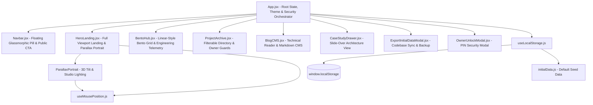
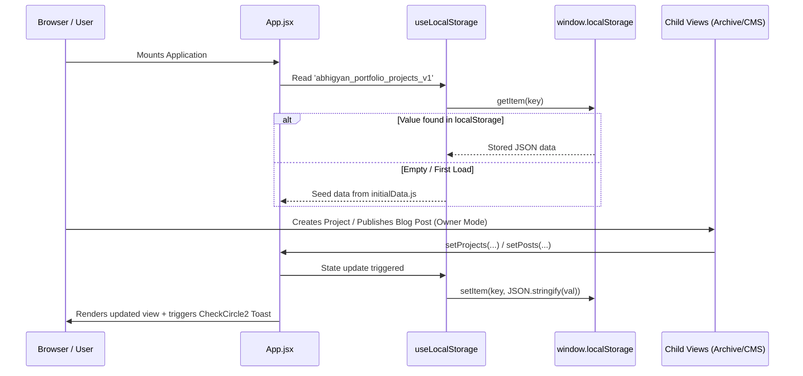
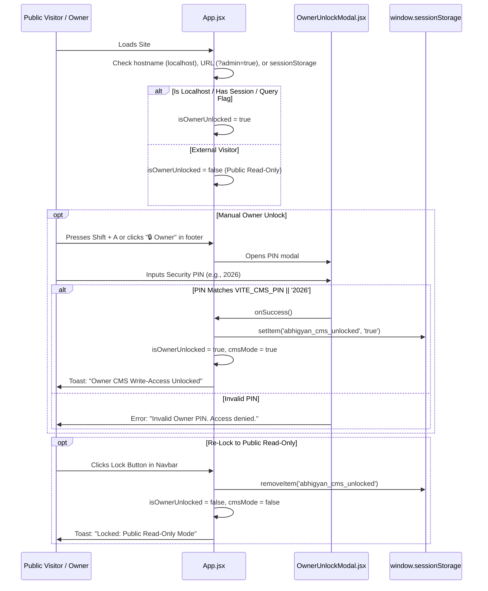

# System Architecture & Technical Specifications

This document outlines the architecture, data flow, component hierarchy, security models, and mathematical geometry powering the **Abhigyan Portfolio & CMS** application.

---

## 1. Component Hierarchy & Flow

---

## 2. State Distribution & Data Lifecycle

---

## 3. Mathematical Models & Coordinate Geometry

### 3.1. 60 FPS Normalized Cursor Tracker (`useMousePosition.js`)

Mouse and mobile gyroscope events are captured with `{ passive: true }` and buffered through `requestAnimationFrame` to ensure zero layout thrashing:

$$\text{nx} = \operatorname{clamp}\left(-1, 1, \frac{2 \cdot X}{\text{viewportWidth}} - 1\right)$$

$$\text{ny} = \operatorname{clamp}\left(-1, 1, \frac{2 \cdot Y}{\text{viewportHeight}} - 1\right)$$

Where:
- $\text{nx} \in [-1, 1]$: Normalized horizontal position (`-1` = left edge, `0` = center, `+1` = right edge).
- $\text{ny} \in [-1, 1]$: Normalized vertical position (`-1` = top edge, `0` = center, `+1` = bottom edge).

### 3.2. 3D Parallax Tilt

The portrait container applies a smooth perspective transform:

$$\text{rotateX} = -\text{ny} \times 4^\circ$$

$$\text{rotateY} = \text{nx} \times 4^\circ$$

$$\text{style} = \text{perspective}(1000\text{px})\;\text{rotateX}(\text{rotateX})\;\text{rotateY}(\text{rotateY})$$

---

## 4. Public Read-Only Security Architecture & Owner Unlock Flow

The application provides a two-tiered security model:
1. **Public Read-Only Mode (Default for all web visitors):**
   - Navigation displays **WRITING** instead of CMS.
   - Navbar right slot displays an interactive **"● Available for Roles"** CTA that copies `abhigyan62001@gmail.com`.
   - CMS editor, project creation modals, delete buttons, and state export triggers are hidden.
   - Star/pin icons in the Project Archive are rendered as read-only indicators.
2. **Owner Write-Access Mode (Authorized Owner):**
   - Unlocked automatically in local environments (`localhost`, `127.0.0.1`), through `?admin=true` URL query parameter, or when a valid session token exists in `sessionStorage`.
   - On-demand unlock via global **`Shift + A`** keyboard listener or discrete `"🔒 Owner"` footer trigger, which opens `OwnerUnlockModal`.
   - Verifies security PIN against `import.meta.env.VITE_CMS_PIN || '2026'`.
   - Upon unlock, owner can toggle `CMS: WRITE` and `CMS: READ`, edit articles, add projects, and sync live state to `initialData.js`.
   - A single click on the **Lock** button in Navbar clears the session and instantly returns the UI to public read-only mode.

---

## 5. Design System Tokens

| Design Token | CSS / Tailwind Class | Hex / HSL Value |
|---|---|---|
| **Background (Dark)** | `bg-[#09090b]` | `hsl(240, 10%, 3.9%)` |
| **Card Surface (Dark)** | `bg-[#111114]` | `hsl(240, 8%, 7%)` |
| **Border Subtle** | `border-zinc-800/80` | `rgba(39, 39, 42, 0.8)` |
| **Accent Emerald** | `text-emerald-400`, `bg-emerald-500` | `#34d399` / `#10b981` |
| **Warm Spotlight Amber** | `from-amber-500/20` | `rgba(245, 158, 11, 0.2)` |
| **Crimson Glow Layer** | `via-rose-600/10` | `rgba(225, 29, 72, 0.1)` |
| **Glass Backdrop Blur** | `backdrop-blur-xl` | `blur(24px)` |
| **Monospace Typography** | `font-mono` | `JetBrains Mono, Fira Code, monospace` |
| **Editorial Serif** | `font-serif`, `font-display` | `Newsreader, Playfair Display, serif` |
